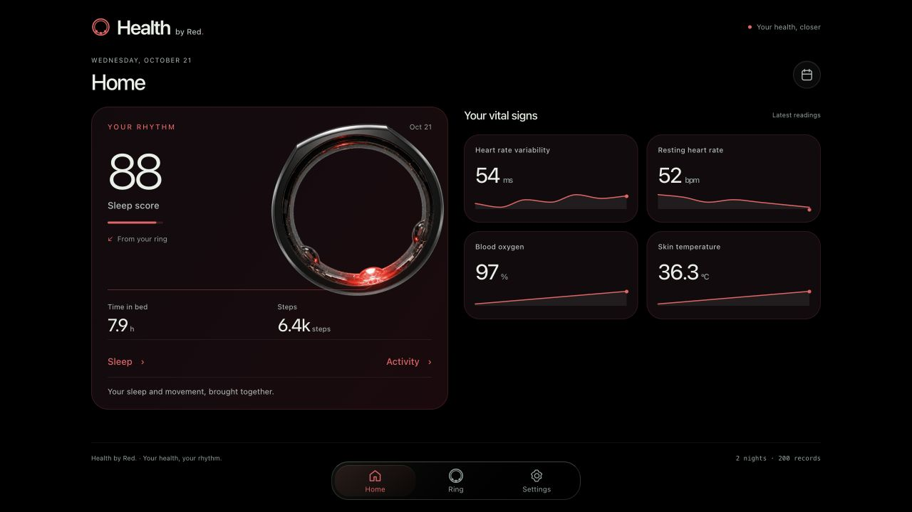

# Health By Red

Your health data, Free. As It should be (and really yours).

A native iOS app and local web dashboard for Oura: sleep, activity, heart rate,
HRV and long-term trends. Built with SwiftUI and Rust, with direct Bluetooth sync
and on-device analysis.

<p align="center">
  
</p>

## Get started

**iOS** — [Build with Xcode](apps/ios/TESTFLIGHT.md) or [Xcode Cloud](apps/ios/XCODE_CLOUD.md).

**Web** — Run locally, then open [localhost:8090](http://127.0.0.1:8090):

```sh
cargo run --release -p oura-cli -- dashboard
```

[Dashboard guide](dashboard/README.md) · [Algorithms](docs/algorithms/README.md) · [Architecture](docs/clients-web-and-ios.md)

MIT licensed. See [LICENSE](LICENSE).

## Interface and source modules

The redesigned clients include light/dark themes, translucent surfaces and an
optional Oura source. Enable it in **Anillo** or **Ajustes → Módulos** before connecting. Local JSON
manifest import currently supports metadata inspection, not executable adapters.
See [module scope](docs/modules/README.md) and the
[focused security review](docs/security-review-2026-10-21.md).
